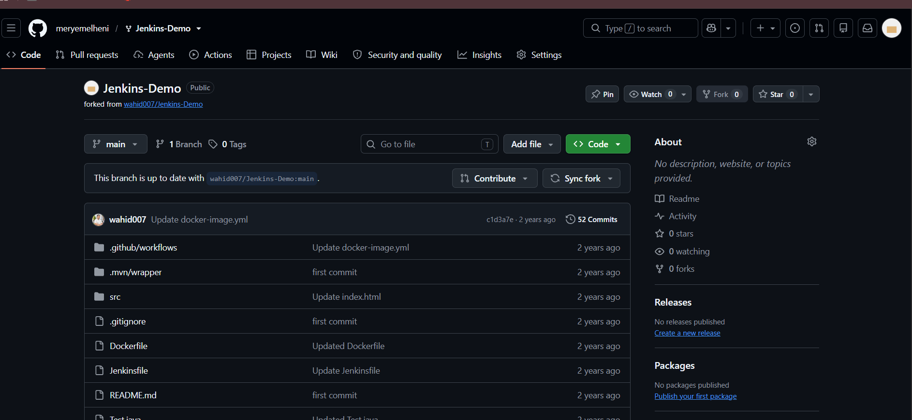
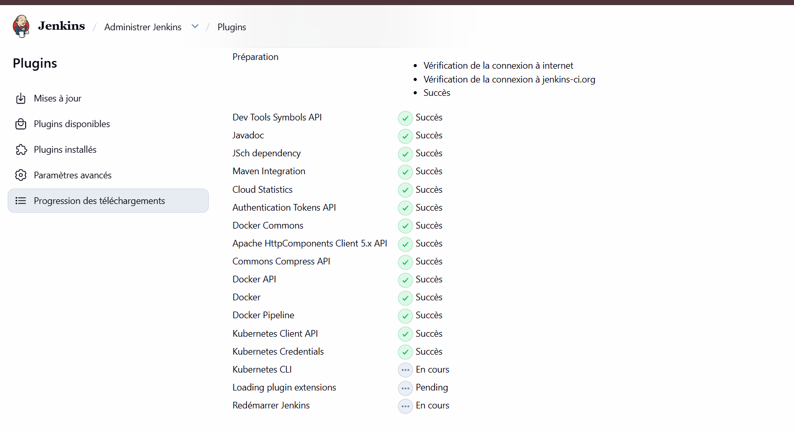
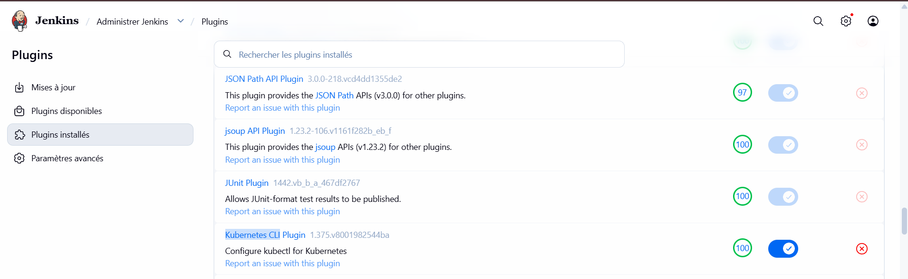
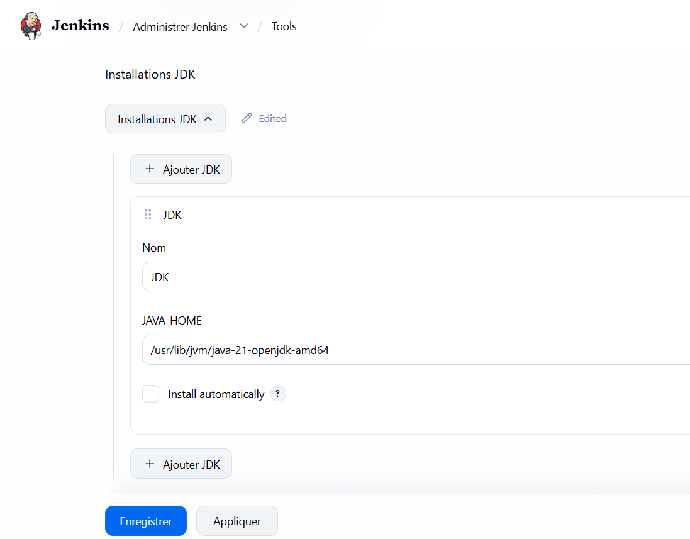
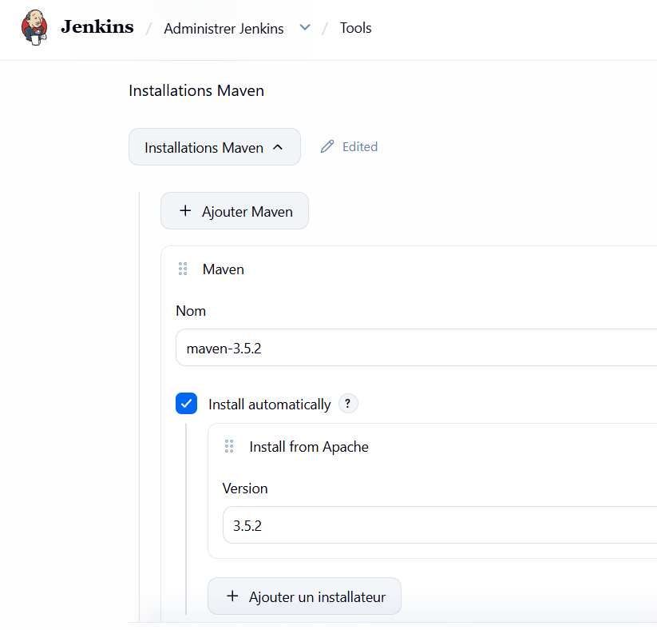
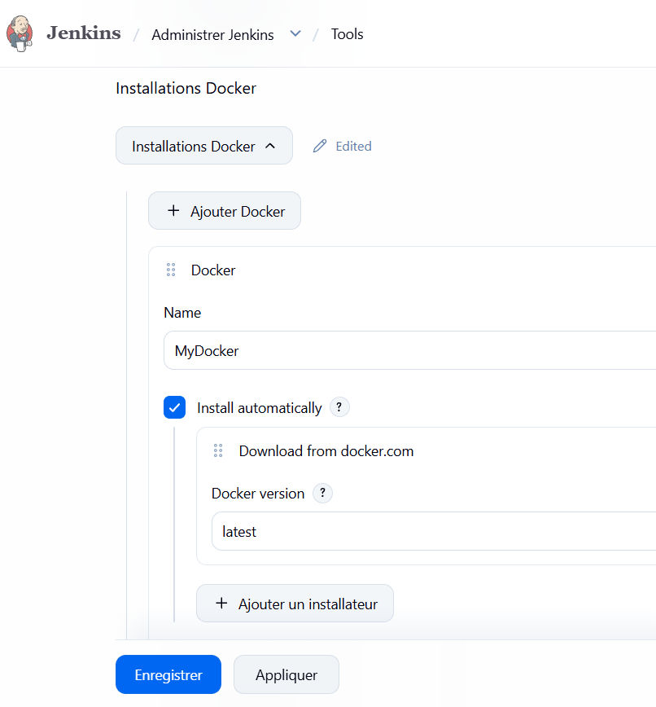
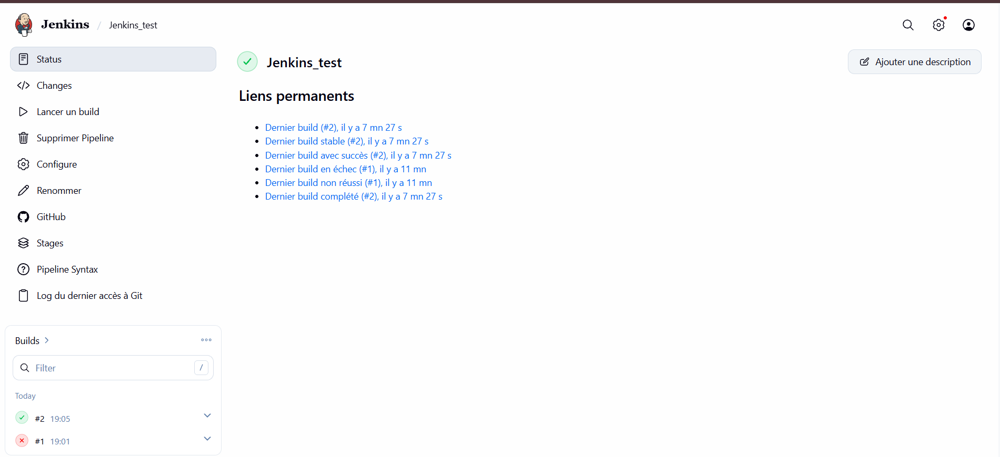
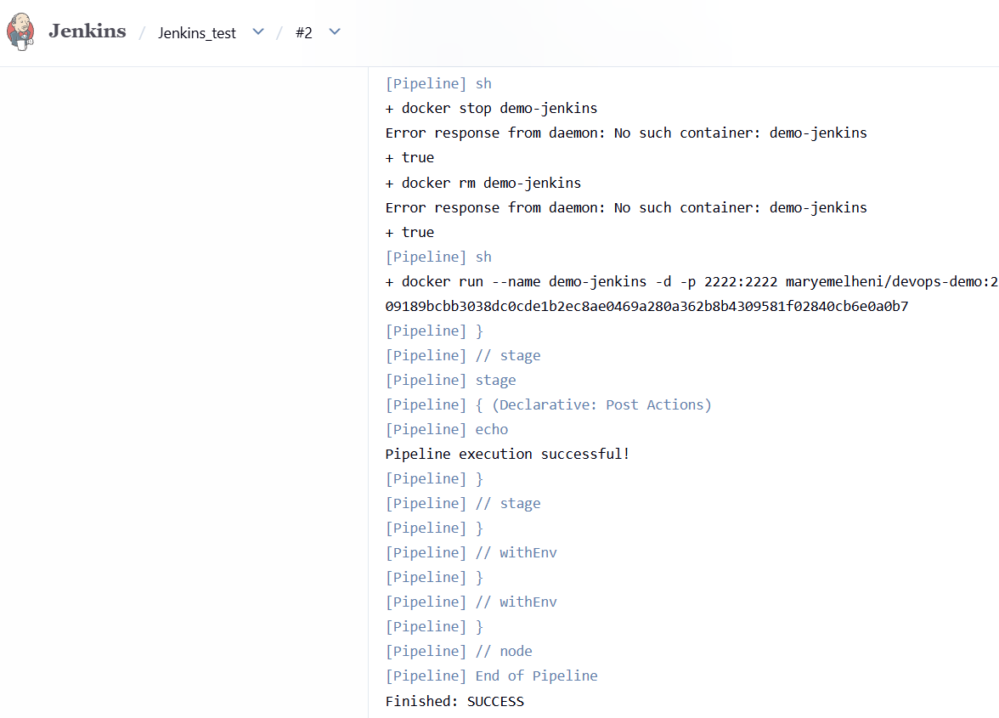
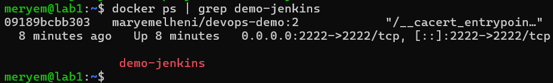
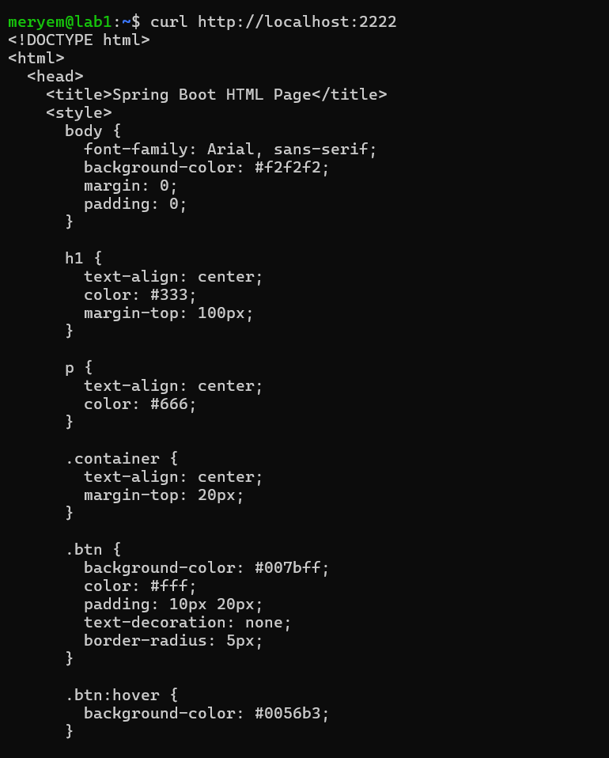

# Lab 2 - CI/CD avec Jenkins (Pipeline)

**Étudiante :** Meryem Elheni  
**Cours :** Jenkins CI/CD Pipeline (Formateur : Wahid Hamdi)

## Objectif

Construire un **pipeline CI/CD complet** avec Jenkins pour une application Spring Boot.  
Le pipeline automatise : clone du dépôt → build Maven → build de l'image Docker → lancement du conteneur.

Ce lab complète le Lab 1 (workflow manuel + freestyle), en utilisant cette fois un **vrai Jenkinsfile déclaratif** versionné dans Git.

## Environnement

- Ubuntu Server 26.04 (VM VMware)
- Docker, Minikube, kubectl
- **Java 21 JDK** (`/usr/lib/jvm/java-21-openjdk-amd64`)
- Jenkins 2.580.1
- Maven 3.5.2
- Git 2.53.0

## Dépôts GitHub

- **Code source (fork)** : https://github.com/meryemelheni/Jenkins-Demo
- **Rapport (ce dépôt)** : https://github.com/meryemelheni/lab2-jenkins-rapport

## Architecture du pipeline

```
GitHub (meryemelheni/Jenkins-Demo)
        │
        │ git clone
        ▼
   ┌──────────────┐
   │  Clone Repo  │
   └──────────────┘
        │
        ▼
   ┌──────────────┐
   │  Build App   │  ← mvn clean package -DskipTests
   └──────────────┘
        │
        ▼
   ┌──────────────┐
   │ Build Image  │  ← docker build (docker pipeline plugin)
   └──────────────┘
        │
        ▼
   ┌──────────────────┐
   │ Deploy Container │  ← docker run -p 2222:2222
   └──────────────────┘
```

## Étape 1 : Fork du dépôt

Fork du dépôt original vers mon compte GitHub :

- Source : `https://github.com/wahid007/Jenkins-Demo`
- Fork  : `https://github.com/meryemelheni/Jenkins-Demo`



## Étape 2 : Installation des plugins Jenkins

Plugins installés via **Administrer Jenkins → Plugins** :

| Plugin | Version | Rôle |
|--------|---------|------|
| Maven Integration | 3.28 | Intégration Maven |
| Docker | 1336.v3711dec712de | Support Docker |
| Docker Pipeline | 653.v2f2c08eff0ec | Docker dans les pipelines |
| Kubernetes CLI | 1.375.v8001982544ba | Accès kubectl depuis les jobs |



Vérification que Kubernetes CLI est bien installé et activé (100/100) :



## Étape 3 : Configuration des outils globaux

Via **Administrer Jenkins → Tools** :

### JDK
- **Nom** : `JDK`
- **JAVA_HOME** : `/usr/lib/jvm/java-21-openjdk-amd64`
- Install automatically : décoché



> **Note** : le paquet `openjdk-21-jre` initial ne contenait pas `javac`. J'ai dû installer `openjdk-21-jdk` pour avoir le compilateur complet :
> ```bash
> sudo apt install openjdk-21-jdk -y
> ```
> Sans `javac`, Maven aurait échoué avec « No compiler is provided in this environment ».

### Maven
- **Nom** : `maven-3.5.2`
- **Install automatiquement** : ✅ Install from Apache → 3.5.2



### Docker
- **Nom** : `MyDocker`
- **Install automatiquement** : ✅ Download from docker.com → latest



## Étape 4 : Création du pipeline

Création d'un job de type **Pipeline** nommé `Jenkins_test` :

- **Général** → GitHub project : `https://github.com/meryemelheni/Jenkins-Demo`
- **Pipeline** → Definition : `Pipeline script from SCM`
- **SCM** : `Git`
- **Repository URL** : `https://github.com/meryemelheni/Jenkins-Demo.git`
- **Branches** : `*/main`
- **Script Path** : `Jenkinsfile`



## Étape 5 : Le Jenkinsfile

Le fichier `Jenkinsfile` versionné dans le dépôt GitHub (branche `main`) :

```groovy
pipeline {
    agent any

    tools {
        maven 'maven-3.5.2'
    }

    environment {
        registry = "maryemelheni/devops-demo"
        dockerImage = ''
    }

    triggers {
        pollSCM('*/5 * * * *')
    }

    stages {
        stage('Clone Repo') {
            steps {
                git branch: 'main', url: 'https://github.com/meryemelheni/Jenkins-Demo.git'
            }
        }

        stage('Build App') {
            steps {
                sh "mvn clean package -DskipTests"
            }
        }

        stage('Build image') {
            steps {
                script {
                    dockerImage = docker.build registry + ":$BUILD_NUMBER"
                }
            }
        }

        stage('Deploy Docker container') {
            steps {
                sh "docker stop demo-jenkins || true && docker rm demo-jenkins || true"
                sh "docker run --name demo-jenkins -d -p 2222:2222 $registry:$BUILD_NUMBER"
            }
        }
    }

    post {
        success { echo 'Pipeline execution successful!' }
        failure { echo 'Pipeline execution failed.' }
    }
}
```

### Adaptation par rapport au Jenkinsfile original

Le `Jenkinsfile` d'origine (fork de `wahid007`) utilisait :

1. `FROM openjdk:17-jdk-slim` dans son `Dockerfile` → **image Docker Hub supprimée**  
   → Remplacée par `eclipse-temurin:17-jre` (image officielle actuelle)
2. `slackSend` dans les stages et le `post` → **Slack non configuré** dans Jenkins  
   → Lignes supprimées pour éviter un échec
3. URL git pointant vers `wahid007/Jenkins-Demo` → **remplacée par le fork** `meryemelheni/Jenkins-Demo`
4. Bloc `tools { maven 'maven-3.5.2' }` → **ajouté** pour lier Jenkins Tools à Maven

### Dockerfile corrigé (version finale)

```dockerfile
FROM eclipse-temurin:17-jre
EXPOSE 2222
WORKDIR /app
COPY target/devOpsDemo-0.0.1-SNAPSHOT.jar app.jar
CMD ["java", "-jar", "app.jar"]
```

## Étape 6 : Lancement du build

Deux builds ont été lancés :

- **Build #1** : ❌ Échec — `openjdk:17-jdk-slim: not found`  
  → cause : image Docker Hub dépréciée
- **Build #2** : ✅ **SUCCESS** — après correction du Dockerfile

Console du build #2 (succès) :



Déroulement du build #2 :
- `Clone Repo` ✅ — clone du fork
- `Build App` ✅ — `mvn clean package` en 13.9 s (BUILD SUCCESS)
- `Build image` ✅ — `docker build -t maryemelheni/devops-demo:2 .`
- `Deploy Docker container` ✅ — `docker run --name demo-jenkins -d -p 2222:2222 ...`
- `Pipeline execution successful!`

## Étape 7 : Vérifications

### Conteneur en cours d'exécution

```bash
docker ps | grep demo-jenkins
```

Résultat :
```
09189bcbb303  maryemelheni/devops-demo:2  "java -jar app.jar"  Up X minutes  0.0.0.0:2222->2222/tcp  demo-jenkins
```



### Test de l'application

```bash
curl http://localhost:2222
```

Résultat (extrait) :
```html
<!DOCTYPE html>
<html>
  <head>
    <title>Spring Boot HTML Page</title>
    ...
  </head>
  <body>
    <h1>Welcome to Jenkins Tutorial for Master DevOps and Cloud!</h1>
    ...
  </body>
</html>
```



## Résultats

✅ Pipeline déclaratif **fonctionnel** sur Jenkins  
✅ Build Maven automatisé (13.9 s)  
✅ Image Docker construite et taguée avec `$BUILD_NUMBER`  
✅ Conteneur lancé automatiquement sur le port 2222  
✅ Application Spring Boot accessible et répond correctement  
✅ Code source du Jenkinsfile versionné dans Git (Infrastructure as Code)

## Points importants / Difficultés rencontrées

1. **JDK vs JRE** : le paquet `openjdk-21-jre` fournit uniquement le runtime (`java`) mais pas le compilateur (`javac`). Sans `javac`, Maven ne peut pas compiler. Solution : installer `openjdk-21-jdk`.
2. **Image Docker dépréciée** : `openjdk:17-jdk-slim` n'existe plus sur Docker Hub. Utiliser `eclipse-temurin:17-jre` à la place.
3. **Plugin Kubernetes CLI bloqué** : le plugin semblait bloqué sur « En cours » dans Jenkins alors qu'il était en réalité déjà installé et activé (bug d'affichage). Vérification via **Plugins installés**.
4. **Noms des outils** : les noms dans `Jenkinsfile` (`maven-3.5.2`, `MyDocker`) doivent correspondre **exactement** à ceux configurés dans **Administrer Jenkins → Tools**.
5. **Slack** : le `Jenkinsfile` d'origine contenait des `slackSend` mais Slack n'est pas configuré → suppression pour éviter l'échec.

## Conclusion

Ce lab m'a permis de :

- Passer d'un **job freestyle** (Lab 1) à un **vrai pipeline Jenkins déclaratif** (Lab 2)
- Comprendre la notion de **Pipeline as Code** (Jenkinsfile versionné dans Git)
- Configurer les **outils globaux** Jenkins (JDK, Maven, Docker)
- Résoudre des problèmes concrets : incompatibilité Java (JRE vs JDK), image Docker obsolète, outils non configurés
- Automatiser **toute la chaîne** : Git → Maven → Docker → Déploiement

Le pipeline peut maintenant être déclenché automatiquement (`pollSCM` toutes les 5 minutes) et reconstruit l'application à chaque changement de code.

## Fichiers du dépôt

```
lab2-jenkins-rapport/
├── README.md                       # ce fichier
├── Jenkinsfile                     # pipeline utilisé (copie)
├── Dockerfile                      # Dockerfile corrigé (copie)
└── screenshots/
    ├── 01-fork.png
    ├── 02-plugins.png
    ├── 03-plugins-installes.png
    ├── 04a-outils-jdk.png
    ├── 04b-outils-maven.png
    ├── 04c-outils-docker.png
    ├── 05-pipeline-config.png
    ├── 06-console-output.png
    ├── 07-docker-ps.png
    └── 08-curl-app.png
```
